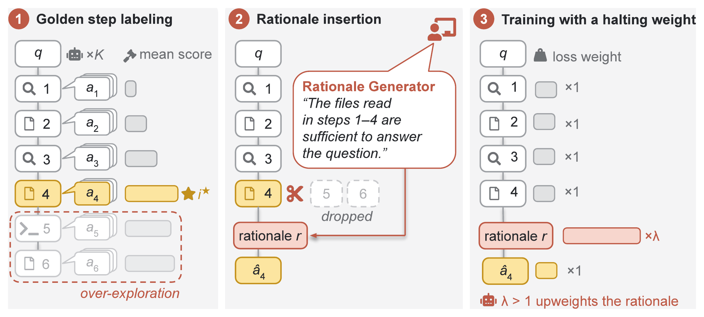
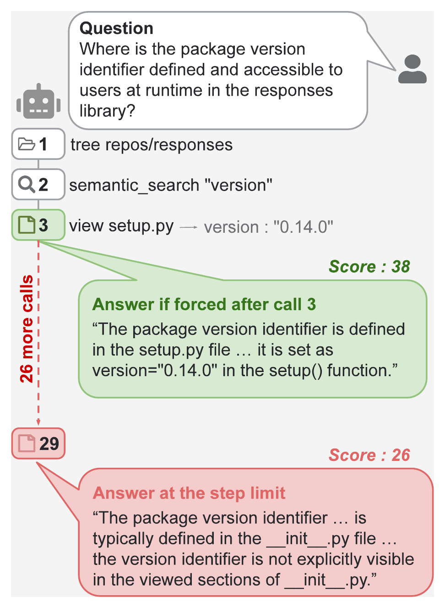
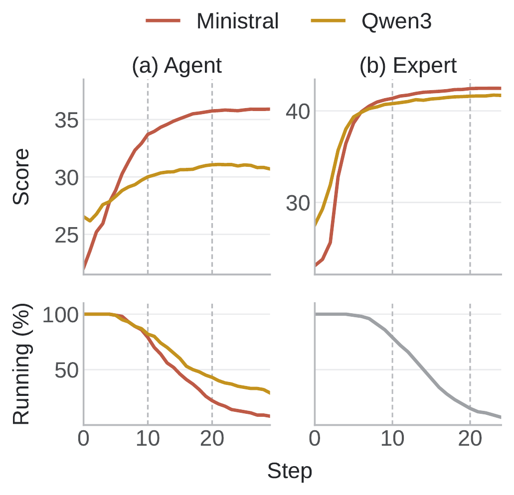
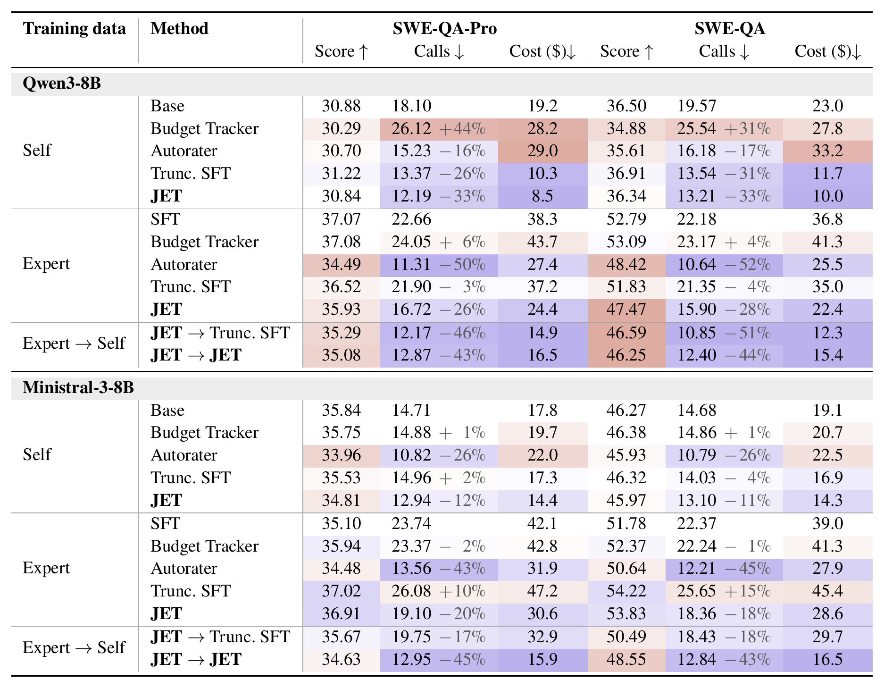

<h1 align="center">JET: Just-Enough Exploration Tuning</h1>

<p align="center">
  <b>Just-Enough Exploration Tuning for Efficient Tool-Calling Agents in Repository-Level Question Answering</b>
</p>

<p align="center">
  <a href="https://arxiv.org/abs/2611.22539"></a>
  <a href="LICENSE"></a>
  
</p>

<p align="center">
  
</p>

## Overview

In repository-level question answering, an agent explores a code repository with tools and should answer once it has
gathered enough information. LLM agents often keep calling tools after that point. We call this **over-exploration**.
Supervised fine-tuning (SFT) on expert trajectories makes it worse, because the agent also imitates the tool calls that
come after the information is already sufficient.

**JET** trains the agent to answer once the gathered information is sufficient.

1. **Golden step labeling.** We force the agent to answer $K$ times after every step of a training trajectory and judge
   each answer. The earliest step with the highest mean score is the *golden step* $i^\star$.
2. **Rationale insertion.** We truncate the trajectory at $i^\star$, and a rationale generator writes why the
   information gathered so far is sufficient to answer.
3. **Training with a halting weight.** We fine-tune the agent with a loss weight $\lambda > 1$ on the rationale.

JET trains on either the agent's own rollouts (**Self**) or expert trajectories (**Expert**).
<table>
  <tr>
    <td width="44%" align="center"></td>
    <td width="56%" align="center"></td>
  </tr>
  <tr>
    <td valign="top"><sub>An example of over-exploration on SWE-QA-Pro (Qwen3-8B). The answer forced after the third
    tool call scores higher than the final answer after 26 more calls.</sub></td>
    <td valign="top"><sub>Forced-answer score (top) and the share of trajectories still exploring (bottom) at each step,
    for (a) the agents on SWE-QA-Pro and (b) the expert trajectories in the SFT data. The score reaches a plateau while
    the exploration continues.</sub></td>
  </tr>
</table>

## Main results

- On self-generated trajectories, JET reduces tool calls by **11 to 33%** while largely preserving the score.
- On expert trajectories, JET makes **18 to 28% fewer tool calls than SFT** while retaining most of the score gain of SFT.
- In both cases, JET also lowers the inference cost.

<p align="center">
  
</p>

<sub>Score is the judge score (maximum 50 on SWE-QA-Pro, 100 on SWE-QA), Calls is the number of tool calls per question,
and Cost is the inference cost per 1,000 questions in US dollars. Percentages are relative to Base in the Self setting
and to SFT in the other two settings. Trunc. SFT trains on the truncated trajectories without the rationale and the
halting weight.</sub>

## Code

The pipeline runs in the order of the folders below. Each folder has its own README with the commands.

- [`build-dataset/`](build-dataset/README.md): golden step labels, rationales, and the training data of JET and
  Truncated SFT, from the Expert trajectories or the agent's own rollouts.
- [`train/`](train/README.md): LoRA training of SFT, Truncated SFT, and JET on Qwen3-8B and Ministral-3-8B.
- [`evaluate-agent/`](evaluate-agent/README.md): agent runs on SWE-QA-Pro and SWE-QA, the Budget Tracker and Autorater
  baselines, and the judges.
- [`reproduce-paper/`](reproduce-paper/README.md): the tables and figures of the paper from the finished runs.
- [`ablation/`](ablation/README.md): the golden step ablation (Table 3).

## Setup

```bash
# 1. Author repositories and benchmark repositories (third_party/README.md)
# 2. One Python 3.10 environment. flash-attn builds from source and needs CUDA toolkit 11.7+ and a C++ compiler
pip install -r requirements.txt
# 3. bubblewrap, for the tool sandbox of the agent
sudo apt install bubblewrap
# 4. API keys of the judges and the autorater
cp .env.example .env && set -a && source .env && set +a
```

## Quick start

To train Qwen3-8B with JET on its own rollouts (**Self**) and evaluate it, follow the steps below. The commands run from
the repository root on one GPU. Replace `qwen3` with `ministral` for Ministral-3-8B. Each step keeps finished items and
resumes when rerun, and `NUM_SAMPLES=1` in step 1 or `--max-steps 2` in step 2 gives a quick try.

```bash
set -a && source .env && set +a
export CUDA_VISIBLE_DEVICES=<gpu>  # GPU index, for example 0

# 1. Training data: rollouts on the RL questions, forced answers, golden steps, and rationales
cd build-dataset
python -m questions.clone
bash scripts/pipeline.sh qwen3 self

# 2. Training: JET, one checkpoint per epoch
cd ../train
bash scripts/jet.sh qwen3 qwen3-self-jet ../build-dataset/rationale/out/qwen3-8b-nothink-self/datasets/JET

# 3. Validation (60 questions): Score and Calls of the base agent and of every checkpoint, to pick one by hand
cd ../evaluate-agent
bash scripts/valid_base.sh qwen3-8b-nothink qwen3
bash scripts/valid.sh qwen3-self-jet qwen3

# 4. Test runs on SWE-QA-Pro and SWE-QA with the selected checkpoint (here epoch 1), the judges, and Score and Calls
bash scripts/jet.sh qwen3-self-jet-e1 qwen3 ../train/JET/out/qwen3-self-jet/checkpoint-25
```

**Checkpoint selection.** From the tables of `valid.sh`, among the checkpoints with fewer validation tool calls than the agent they are compared with,
we take the one with the highest validation score, or the one with the fewest tool calls if none has fewer. The agent
compared with is the base agent in Self, the SFT agent in Expert, and the Expert JET agent in Expert → Self. For SFT we
take the highest score.

**Expert.** To train with JET on the Expert trajectories, follow the commands below. The SFT agent is trained first as
the agent compared with.

```bash
cd build-dataset && bash scripts/pipeline.sh qwen3 expert
cd ../train
bash scripts/sft.sh qwen3 qwen3-sft
bash scripts/jet.sh qwen3 qwen3-expert-jet ../build-dataset/rationale/out/qwen3-8b-nothink/datasets/JET
cd ../evaluate-agent
bash scripts/valid.sh qwen3-sft qwen3
bash scripts/valid.sh qwen3-expert-jet qwen3
bash scripts/jet.sh qwen3-expert-jet-e3 qwen3 ../train/JET/out/qwen3-expert-jet/checkpoint-189   # here epoch 3
```

**Expert → Self.** To continue training the Expert JET agent on its own rollouts, follow the commands below. The
selected Expert JET checkpoint makes the rollouts, and training continues from the same checkpoint.

```bash
EXPERT=$PWD/train/JET/out/qwen3-expert-jet/checkpoint-189
cd build-dataset && bash scripts/pipeline_two_stage.sh qwen3 $EXPERT
cd ../train
bash scripts/jet.sh qwen3 qwen3-expert-to-self-jet \
    ../build-dataset/rationale/out/qwen3-8b-nothink-expert-to-self/datasets/JET --init-adapter $EXPERT
cd ../evaluate-agent
bash scripts/valid.sh qwen3-expert-to-self-jet qwen3
bash scripts/jet.sh qwen3-expert-to-self-jet-e1 qwen3 ../train/JET/out/qwen3-expert-to-self-jet/checkpoint-25
```

- **Truncated SFT and the baselines.** Each method has a training script in `train/scripts/` and an evaluation script
  in `evaluate-agent/scripts/` (`base.sh`, `budget_tracker.sh`, `autorater.sh`, `sft.sh`, `truncated_sft.sh`, `jet.sh`).
- **Tables and figures.** Set your run ids in the scripts of `reproduce-paper/` and run `bash reproduce-paper/run.sh`.
- The judges are hosted models, and vLLM is not bit-exact across GPUs, so scores can differ slightly from the paper.

## Citation

```bibtex
@article{choi2026jet,
  title={JET: Just-Enough Exploration Tuning for Efficient Tool-Calling Agents in Repository-Level Question Answering},
  author={Choi, Yoonho and Han, Taehyeon and Lee, Seonghyeon},
  journal={arXiv preprint arXiv:2611.22539},
  year={2026}
}
```

## Acknowledgements

We thank the authors of [SWE-QA-Pro](https://github.com/TIGER-AI-Lab/SWE-QA-Pro),
[SWE-QA](https://github.com/peng-weihan/SWE-QA-Bench), and
[budget-aware-agent](https://github.com/google-research/budget-aware-agent) for releasing their code and data. We build
on the agent scaffold, data, and judge of SWE-QA-Pro, the benchmark of SWE-QA, and the Budget Tracker prompt of
budget-aware-agent. Training uses [TRL](https://github.com/huggingface/trl), and the agents are served with
[vLLM](https://github.com/vllm-project/vllm).

## License

MIT ([LICENSE](LICENSE)). The repositories in `third_party/` keep their own licenses.
